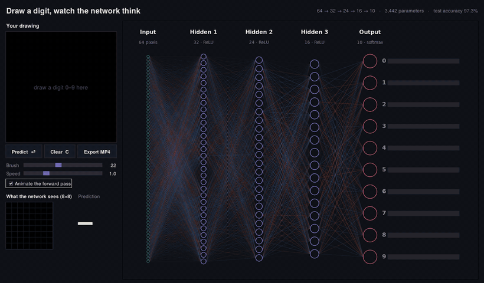
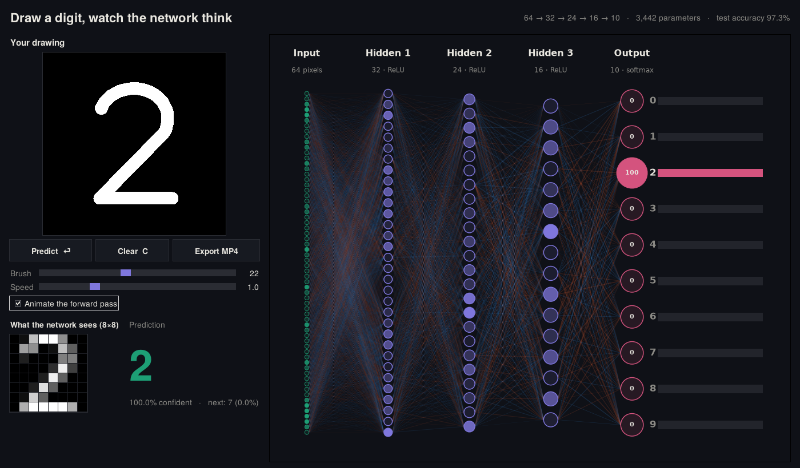

# Digit NN Visualizer

Draw a digit with your mouse or on a touchscreen, and watch a neural network recognise it.
The drawing is shrunk to the 8×8 pixels the network sees, and the signal is animated as it
flows from the pixels, along the weighted connections, through three hidden layers, to the
final prediction.



## Features

- **Draw anywhere.** Use the mouse, a pen, or a finger on a touchscreen.
- **See what the model sees.** Live 8×8 preview of your digit after preprocessing.
- **Animated forward pass.** Pulses travel along each link, sized by `activation × weight`. Neurons light up by activation, and output probabilities fill in.
- **Real trained model.** A 64 → 32 → 24 → 16 → 10 network (3,442 parameters), so every number on screen is real.
- **Export to MP4.** Save a 1080p video of *your* digit going through the network.
- **Automatic session recording.** Everything you do in the app is recorded and saved as an MP4 when you close it.
- **No pickle issues.** Weights are stored as plain NumPy arrays and the forward pass is written in NumPy, so the saved model works with any scikit-learn version.



## Quick start

```bash
git clone https://github.com/murad-sciml/digit-nn-visualizer.git
cd digit-nn-visualizer
pip install -r requirements.txt
python app.py
```

With conda:

```bash
conda create -n digit-nn python=3.12 -y
conda activate digit-nn
pip install -r requirements.txt
python app.py
```

Tkinter ships with Python on Windows and macOS. On Linux you may need `sudo apt install python3-tk`.

### Controls

| Action | How |
|---|---|
| Draw | Left mouse button, pen, or finger |
| Predict | Lift the pen (automatic), or press **Enter** |
| Clear | **C** or **Esc**, or the Clear button |
| Export video | **Export MP4** button (takes about a minute) |
| Stop and save the session recording | Close the window |

Tip: draw one large digit that fills most of the box, like a printed number.

## How it works

```
drawing (320×320) ─► crop ─► scale to fill 32×32 ─► binarise + thicken ─► 4×4 block average ─► 8×8
                                                                                           │
             prediction ◄─ softmax(10) ◄─ ReLU(16) ◄─ ReLU(24) ◄─ ReLU(32) ◄─ 64 inputs ◄───┘
```

1. **Dataset.** The model is trained on scikit-learn's [handwritten digits](https://scikit-learn.org/stable/datasets/toy_dataset.html#optical-recognition-of-handwritten-digits-dataset) (1,797 images, 8×8, from the UCI *optdigits* set).
2. **Preprocessing (`nn_viz/preprocess.py`).** This repeats how that dataset was made, so your drawing looks like the training data. Each digit is scaled so it fills the full height of a 32×32 bitmap. Thin strokes are thickened until about 27% of the grid is ink, which matches the dataset. Then each 4×4 block is averaged into one of the 64 inputs.
3. **Training (`nn_viz/model.py`).** The network is a scikit-learn `MLPClassifier`, trained with random rotations, shifts and zooms (data augmentation) so it copes with hand-drawn input. Test accuracy is about 97%.
4. **Visualization (`nn_viz/network_view.py`).** One Matplotlib renderer is driven by a single `progress` value. It's used for both the live GUI and the exported video.

## Project structure

```
digit-nn-visualizer/
├── app.py                    # Tkinter GUI (run this)
├── recordings/               # session videos (created automatically, git-ignored)
├── train.py                  # retrain the network → models/digits_mlp.npz
├── models/digits_mlp.npz     # trained weights (committed, about 30 KB)
├── nn_viz/
│   ├── model.py              # Network class, forward pass, training
│   ├── preprocess.py         # drawing → 8×8 conversion
│   ├── network_view.py       # animated network renderer (Matplotlib)
│   ├── video.py              # MP4 export (bundled ffmpeg fallback)
│   └── recorder.py           # records the app window while it runs
├── scripts/
│   └── render_demo_video.py  # standalone 1080p demo video of test-set digits
├── tests/                    # pytest tests
└── assets/                   # README images
```

## Session recording

When the app starts, it records its own window. A red **● REC** timer appears next to the title. When you close the window, the video is saved automatically:

```
recordings/session_20261020_175755.mp4
```

The saved path is also printed in the terminal. Video plays back in real time, at 15 fps by default.

```bash
python app.py --no-record   # run without recording
python app.py --fps 30      # smoother recording (larger files)
```

The recorder captures the screen area where the window is. If another window covers the app, that window appears in the video too. Pressing Ctrl+C in the terminal also saves the recording.

## Retraining

```bash
python train.py               # with augmentation (best for drawing)
python train.py --no-augment  # plain dataset (≈98% test accuracy, weaker on drawings)
```

To try a different architecture, change `HIDDEN = (32, 24, 16)` in `nn_viz/model.py` and retrain. The GUI adapts automatically.

## Tests

```bash
pip install pytest
pytest
```

## Troubleshooting

- **`FileNotFoundError: [WinError 2]` when exporting video.** FFmpeg isn't found. Install it with `pip install imageio-ffmpeg` (the app uses its bundled binary automatically) or `conda install -c conda-forge ffmpeg`.
- **Wrong predictions.** The network only sees 8×8 = 64 pixels and was trained on digits from 43 writers, so unusual styles can fool it. Draw larger, centered, and in a printed style. A 7 with a crossbar or a closed-top 4 are the usual troublemakers.
- **Blurry window on Windows.** The app enables high-DPI awareness. If text still looks small, change the Windows display scaling.

## License

MIT. See [LICENSE](LICENSE).
